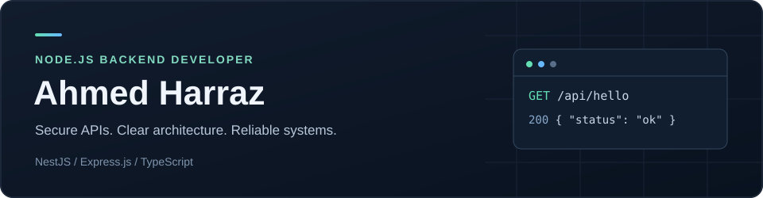

  

  
  
  

## Hi, I'm Ahmed 👋

**Backend Developer · Node.js · NestJS · TypeScript**

Based in Cairo, Egypt. I build secure APIs, modular backend services, and real-time systems, with a focus on authentication, payments, background jobs, and performance.

Currently a **Backend Developer at Penta-K**, previously at **Travolic**.

## Skills

| Area | Technologies |
| --- | --- |
| Languages & backend | TypeScript · JavaScript · Node.js · NestJS · Express.js · Fastify |
| Databases & ORMs | PostgreSQL · MongoDB · MySQL · TypeORM · Sequelize · Prisma · Mongoose |
| Queues & real-time | Redis · BullMQ · Socket.IO · Redis Pub/Sub |
| Authentication & security | JWT · OAuth2 · Refresh Token Rotation · OTP · RBAC · Rate Limiting |
| Payments & media | Paymob · Stripe · AWS S3 · Cloudflare R2 · Cloudinary · FFmpeg |
| Notifications | Firebase FCM · Nodemailer |
| DevOps & tools | Docker · Docker Compose · Jenkins · Git · Postman · Railway · Vercel |

## Main project

*These projects are maintained in private repositories. The summaries below highlight my backend contributions.*

### Call99 — Automotive Services Marketplace

A backend for car wash, roadside assistance, towing, and car rental, with Paymob payments, background workers, real-time tracking, and chat.

**NestJS · TypeScript · PostgreSQL · TypeORM · Redis · BullMQ · Socket.IO · Paymob**

[API documentation — Swagger (development)](https://back-dev-call99.penta-k.com/api/docs)

## Other projects

- **Ganzo Platform** — Education backend with courses, subscriptions, secure media, and chat.
- **Szissors** — Barber booking backend with role-based access and provider onboarding.
- **SmartFix** — Home maintenance backend with service bookings, payments, and notifications.

---

**B.Sc. in Computer Science, Tanta University · 2026**

[LinkedIn](https://www.linkedin.com/in/ahmed-harraz-b52197268/) · [Email](mailto:aharraz63hid@gmail.com)
